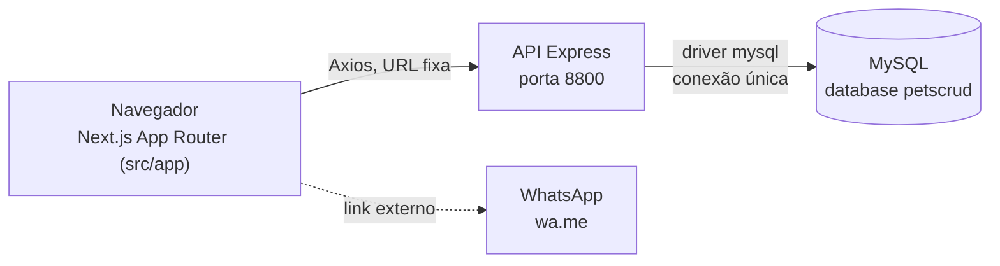
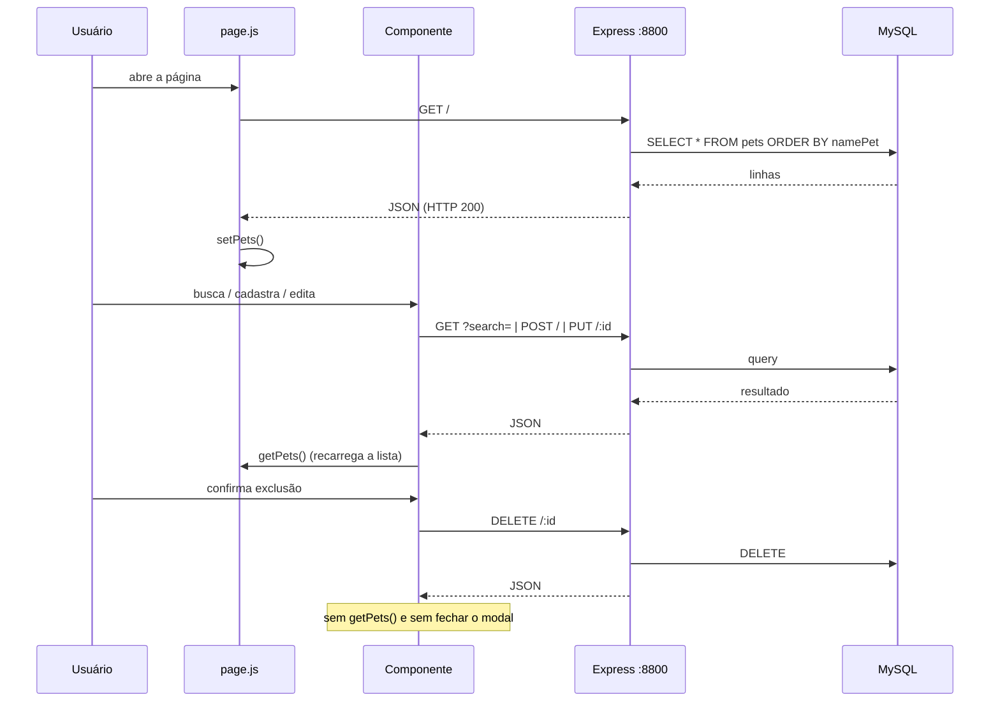

# ARQUITETURA.md — Estrutura técnica e fluxo de dados

> Refere-se ao estado **atualmente implementado** no repositório. Propostas de organização aparecem apenas na §8 e não devem ser lidas como arquitetura já adotada.

## 1. Visão geral

Três camadas distintas no repositório:

| Camada | Localização | Tecnologia (faixa declarada) |
|---|---|---|
| Interface | `src/app` + `src/components` | Next.js `^14.2.3`, React `^18.2.0` |
| API | `api/` | Express `^4.19.2` |
| Persistência | `api/db.js` | driver `mysql` `^2.18.1` |

Os números acima são **faixas declaradas** nos manifests, não versões instaladas comprovadas. A versão instalada só é definida para a API, pelo lockfile — ver §6.

Não há ORM, camada de serviço separada, repositório ou injeção de dependência. Os controllers chamam o driver diretamente.

---

## 2. Frontend

### 2.1. App Router
- `src/app/layout.js` — layout raiz, fonte Ubuntu, `lang="pt-Br"`, metadata `title: "SOFT PET"`.
- `src/app/page.js` — *client component* (`"use client"`). Mantém o estado `pets` e `onEdit`, dispara `getPets()` no `useEffect` e renderiza `<Principal />` e o `<ToastContainer />` estilizado com styled-components.
- `src/app/globals.css` — variáveis CSS (gradientes, cores, tamanhos, pesos).
- `src/app/page.module.css` — **vazio** (apenas espaços em branco), porém importado em `page.js`.

### 2.2. Componentes em `src/components/`
Os componentes compartilhados vivem fora de `src/app`, em `src/components/` — **fora das convenções de roteamento** (`app`/`pages`). A pasta `src/pages/` deixou de existir no workspace real na sessão SOFTPET-011 (QLT-010 `FIXED`); antes disso esta árvore participava da convenção do Pages Router porque `next.config.mjs` **não define `pageExtensions`**, e o build de produção falhava nos arquivos sem export default.

| Arquivo | Exportação | Observação |
|---|---|---|
| `Form.js` | nomeada (`export function Form`) | Não é importado por nenhum arquivo do projeto. Sua localização o coloca sob a convenção de rotas. |
| `SearchFilter.js` | nomeada | Usado por `principal.js`. |
| `bloco-info/Bloco.js` | default | Card da lista; gerencia expansão, modais de edição/exclusão e o link de WhatsApp. |
| `modal/ModalCad.js` | default | Modal de cadastro. |
| `modal/ModalEdit.js` | default | Modal de edição. |
| `modal/ModalDel.js` | default | Modal de exclusão. |
| `modal/buttons.js` | nomeadas | `ButtonBack`, `ButtonSave`, `ButtonEdit`, `ButtonDelete`, `IconeCadastro`, `IconeEditar`, `IconeDeletar`. |
| `principal/principal.js` | default | Orquestrador: logo, busca, botão de cadastrar e a lista de cards. |

Os três arquivos com **apenas exportação nomeada** (`Form.js`, `SearchFilter.js`, `buttons.js`) foram a causa da falha de build sob a antiga localização — **confirmado por execução** na SOFTPET-010 (§10 do `QUALITY-REVIEW.md`) e **resolvido pelo move** na SOFTPET-011 (build exit 0 — §11). O conteúdo dos arquivos não foi alterado pelo move.

### 2.3. Estilização
- CSS puro com variáveis em `globals.css`, distribuído em `bloco.css`, `modal.css`, `button.css`, `style.css`.
- `styled-components` `^6.1.11` é usado em `page.js` (container do toast) e tem um bloco `webpack` em `next.config.mjs` com `resolve.fallback` **vazio**. Não há plugin SWC/Babel configurado para styled-components no App Router. Consequência prática **não verificada**.
- `jsconfig.json` define o alias `@/*` → `./src/*`.

---

## 3. API

### 3.1. Configuração (`api/index.js`)
`express.json()` e `cors()` sem restrição de origem. Rotas montadas em `/`. Servidor na porta **8800**, sem variável de ambiente.

### 3.2. Rotas (`api/routes/pets.js`)

| Método | Rota | Controller | Validação de entrada |
|---|---|---|---|
| `GET` | `/` | `getPets` | Nenhuma |
| `POST` | `/` | `addPets` | Nenhuma |
| `PUT` | `/:id` | `updatePets` | Nenhuma |
| `DELETE` | `/:id` | `deletePets` | Nenhuma |

Não há autenticação, autorização, rate limiting nem middleware de tratamento de erros.

### 3.3. Queries (`api/controllers/pet.js`)

| Controller | Comportamento observado |
|---|---|
| `getPets` | Com `?search=`, monta `LIKE '%<termo>%'` por **interpolação direta do valor na string SQL**; sem o parâmetro, usa `SELECT * FROM pets ORDER BY namePet`. |
| `addPets` | `INSERT` com placeholder `?` e array de valores. |
| `updatePets` | `UPDATE` parametrizado por `WHERE id = ?`. |
| `deletePets` | `DELETE` parametrizado por `WHERE id = ?`. |

Em todos os controllers, o erro do driver é devolvido com `res.json(err)` — **sem status de erro explícito**, ou seja, com HTTP 200. `updatePets` e `deletePets` respondem mensagem de sucesso sem conferir quantas linhas foram afetadas.

---

## 4. Persistência

`api/db.js` cria **uma única conexão** (`mysql.createConnection`) com a configuração obtida **exclusivamente do ambiente de execução**: `process.env` → `readDatabaseConfig` (`api/config/database.js`) → `mysql.createConnection`. As quatro variáveis obrigatórias são `DB_HOST`, `DB_USER`, `DB_PASSWORD` e `DB_NAME`; a ausência ou string vazia de qualquer delas faz o processo **falhar antes de construir a conexão**, com mensagem listando apenas os nomes. Sem fallback embutido. `api/.env.example` documenta os nomes com placeholders; `.env` está fora do versionamento e **não é carregado automaticamente** pelo aplicativo — o carregamento é responsabilidade do processo de execução/launcher. Implementado na sessão SOFTPET-015 (2026-11-05); decisão registrada como D8 em `memory-bank/DECISIONS.md`.

Os valores de credencial não são reproduzidos neste documento. A rotação da credencial historicamente publicada permanece ação operacional pendente (SEC-005).

### 4.1. Campos usados nas queries × schema conhecido

| Campo da query | Origem |
|---|---|
| `id`, `namePet`, `nameDono`, `telefone`, `animal`, `raca`, `data` | Inferidos das strings SQL em `api/controllers/pet.js` |

**O schema efetivo da tabela `pets` não é conhecido.** Não há DDL, migration, seed nem arquivo de schema entre os arquivos próprios do projeto. Tipos, chaves primárias, constraints, índices e comportamento de `id` não puderam ser confirmados.

---

## 5. Fluxo de dados

O estado da lista vive em `page.js` e é repassado por props para `principal.js` e `Bloco.js`. Cadastro e edição recarregam a lista via `getPets()`; **exclusão não recarrega**.

---

## 6. Dependências principais

> As versões abaixo são **faixas declaradas** nos manifests. A coluna de versões **resolvidas** só existe onde há lockfile.

### Raiz (`package.json`)

`next` `^14.2.3`, `react`/`react-dom` `^18.2.0`, `styled-components` `^6.1.11`, `react-hook-form` `^7.51.5`, `zod` `^3.23.8`, `@hookform/resolvers` `^3.4.2`, `react-modal` `^3.16.1`, `react-toastify` `^10.0.5`, `axios` `^1.7.2`, `express` `^4.19.2`, `cors` `^2.8.5`, `eslint-config-next` `^13.5.6`.

**Situação:** sem lockfile versionado no repositório. Há hoje um lockfile **local** (não rastreado, origem não confirmada) — a árvore resolvida por ele é observação local e não prova a versão originalmente usada pelo projeto.

**Declaradas sem importação identificada em código:** `@aws-sdk/credential-providers`, `@mongodb-js/zstd`, `aws4`, `gcp-metadata`, `mongodb`, `mongodb-client-encryption`, `snappy`, `mongoose`.

### API (`api/package.json`)

| Pacote | Declarado | Resolvido no lockfile |
|---|---|---|
| `express` | `^4.22.3` | 4.22.3 |
| `cors` | `^2.8.5` | 2.8.5 |
| `mysql` | `^2.18.1` | 2.18.1 |
| `nodemon` | `^3.1.1` | 3.1.1 |

### Lockfiles — situações distintas

| Local | Lockfile | Consequência |
|---|---|---|
| Raiz | **Não versionado**; há lockfile local (não rastreado, origem não confirmada) | Instalação não definida pelo repositório; a resolução local é observação, não autoridade |
| `api/` | **Presente** | Instalação reproduzível; versões resolvidas conhecidas |

`node_modules` da raiz existe hoje em nível local (origem não confirmada) e não é versionado — é justamente o que `/node_modules` no `.gitignore` exclui.

---

## 7. Configurações presentes e limitações

| Item | Situação |
|---|---|
| `next.config.mjs` | Apenas `webpack` com `resolve.fallback` vazio; sem `pageExtensions`, sem plugin styled-components |
| `jsconfig.json` | Alias `@/*` → `./src/*` |
| `.gitignore` | Contém somente `/node_modules` — não cobre `api/node_modules` nem `.next`, ambos versionados |
| `.env` | Inexistente; nenhuma variável de ambiente é lida pelo código |
| CI/CD | Inexistente — nenhum pipeline encontrado |
| Testes | Inexistentes — nenhum teste próprio nem framework configurado |
| URL da API | Fixa em `http://localhost:8800`, repetida em 6 arquivos do frontend |

---

## 8. Propostas de organização (não implementadas)

São apenas propostas, a confirmar antes de executar:

- Centralizar a URL da API em um único módulo de configuração, para eliminar as seis ocorrências repetidas.
- ~~Definir a conexão do banco por variáveis de ambiente, com `.env` fora do versionamento e `.env.example` documentando os nomes.~~ **Implementado na SOFTPET-015** (2026-11-05) — ver §4 e decisão D8 no `memory-bank/DECISIONS.md`.
- ~~Avaliar se `src/pages/componentes/` deve permanecer sob a convenção de rotas do Pages Router ou ser movida para fora de `src/pages`.~~ **Implementado na SOFTPET-011** — a árvore foi movida para `src/components/` (decisão D7 no `memory-bank/DECISIONS.md`; estado atual na §2.2).
- Registrar o DDL da tabela `pets` no repositório, para que o schema deixe de ser inferido apenas pelas queries.
- Considerar `mysql.createPool()` no lugar de `createConnection()` quando houver concorrência real.

Nenhuma dessas propostas foi aprovada. Decisões efetivas vão para `memory-bank/DECISIONS.md`.
