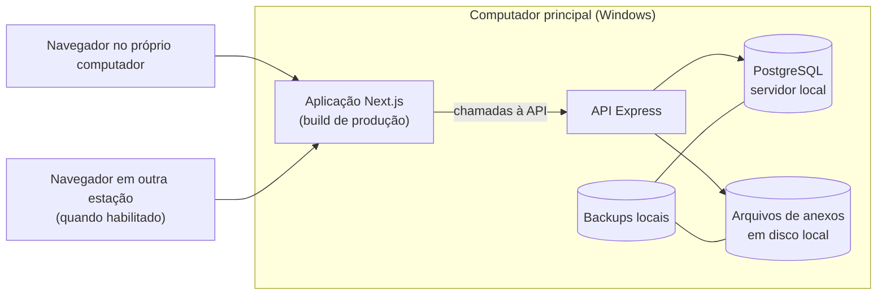
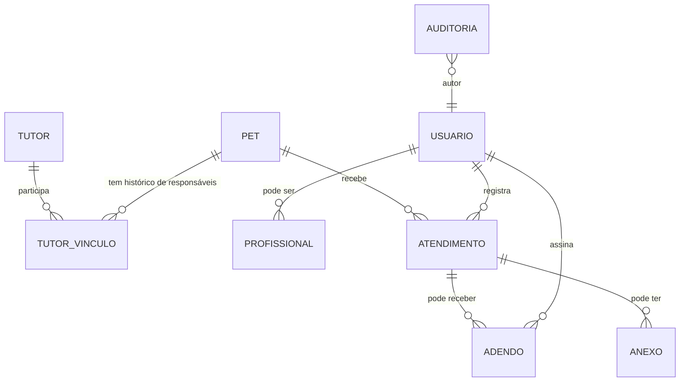

# PLANO-COMERCIAL-LOCAL.md — Evolução para produto local com prontuário veterinário

> Documento de **planejamento**, produzido na rodada **SOFTPET-005**, em 2026-11-04.
>
> **Nada aqui foi implementado.** Nenhuma linha de código, CSS, manifesto, lockfile, `.gitignore` ou arquivo de ambiente foi alterada nesta rodada. Nenhuma dependência foi instalada ou atualizada. Nenhum build, dev, teste ou `npm audit` foi executado. Nenhuma conexão com o banco foi tentada. Nenhuma migration foi criada ou executada. Nenhum stage, commit ou push foi feito.
>
> **Execução manual.** As skills `project-bootstrap`, `security-audit`, `quality-review` e `safe-implementation` **não estão instaladas neste ambiente** — reconfirmado nesta rodada em `c:\Users\vitor2\.copilot\skills\` (37 diretórios, nenhuma das quatro) e em `c:\Users\vitor2\.claude\skills\`, `d:\projetos\PetShop\.claude\skills\` e `d:\projetos\PetShop\.github\skills\` (todos inexistentes). A metodologia foi aplicada **manualmente**. **Nenhuma skill foi executada.**

---

## 1. Como ler este documento

Este documento separa explicitamente quatro tipos de afirmação, e elas **não devem ser lidas umas como as outras**:

| Marca | Significado |
|---|---|
| **[VERIFICADO]** | Lido diretamente em arquivo deste repositório, com referência ao arquivo |
| **[CONFIRMADO PELO USUÁRIO]** | Requisito declarado pelo usuário nesta rodada |
| **[HIPÓTESE]** | Premissa adotada para permitir planejar; **não** foi aprovada como decisão |
| **[PROPOSTA]** | Decisão técnica sugerida; **não** está aprovada e nada aqui a torna obrigatória |
| **[PENDÊNCIA]** | Informação necessária que ainda não foi obtida |

O que existe hoje está descrito nos documentos próprios do projeto (`README.md`, `PROJETO.md`, `docs/ARQUITETURA.md`, `SECURITY-AUDIT.md`). Este documento **não reescreve** essa descrição — ele acrescenta o **futuro proposto**, sempre identificado como proposta.

---

## 2. Estado atual verificado

Tudo nesta seção foi lido em arquivo nesta rodada.

### 2.1 Stack efetivamente utilizada

| Camada | Stack real | Evidência |
|---|---|---|
| Interface | Next.js (App Router em `src/app`) + React, client-side | `package.json`, `src/app/layout.js`, `src/app/page.js` |
| API | Express, ESM (`"type": "module"`) | `api/package.json`, `api/index.js` |
| Persistência | **MySQL**, driver `mysql` | `api/db.js` → `mysql.createConnection({...})` |

### 2.2 Fluxo entre interface, API e banco

`src/app/page.js` e `src/pages/componentes/**` chamam a API via **Axios com URL absoluta fixa** → `api/index.js` monta `express.json()` e `cors()` sem restrição → rotas em `api/routes/pets.js` → controllers em `api/controllers/pet.js` → driver `mysql`.

Não há ORM, camada de serviço, repositório ou injeção de dependência: o controller chama o driver diretamente. **[VERIFICADO]**

### 2.3 Integração MySQL existente

`api/db.js` **[VERIFICADO]** — uma **única conexão** (`createConnection`, não pool), com host, usuário, senha e database como **literais no código**. Nenhum arquivo `.env` no repositório, nenhuma leitura de `process.env` no código. Os valores não são reproduzidos neste documento.

Consequência direta para o objetivo comercial: **uma instalação em outra máquina não funciona sem editar código-fonte.** **[VERIFICADO]**

### 2.4 MongoDB / Mongoose — utilização real

**Nenhuma utilização encontrada.** Busca por `mongoose|mongodb|snappy|zstd|aws4|gcp-metadata|credential-providers` em `src/**`: **zero ocorrências**. Os arquivos de `api/` importam apenas `express`, `cors` e `mysql`. **[VERIFICADO]**

Ou seja: `mongodb`, `mongoose`, `snappy`, `@mongodb-js/zstd`, `mongodb-client-encryption`, `@aws-sdk/credential-providers`, `aws4` e `gcp-metadata` estão **declarados no `package.json` da raiz sem importação identificada**. **[VERIFICADO]** São dependências de manifesto, não dependências de código.

**Diferenciação pedida — declarada × resolvida × instalada:**

| Pacote | Declarado em `package.json` | Resolvido no lockfile | Instalado (verificável por leitura) |
|---|---|---|---|
| `express` (API) | `^4.19.2` | 4.19.2 | 4.19.2 — conferido em `api/node_modules` |
| `mysql` (API) | `^2.18.1` | 2.18.1 | — |
| `cors` (API) | `^2.8.5` | 2.8.5 | — |
| `nodemon` (API) | `^3.1.1` | 3.1.1 | — |
| `next` (raiz) | `^14.2.3` | presente no lockfile da raiz | presente em `node_modules` da raiz |

**Ressalva exigida:** o `package-lock.json` da raiz é uma **resolução local observada nesta máquina** — ele não é prova das versões originalmente utilizadas pelo projeto quando foi escrito. **[VERIFICADO]** A API tem lockfile próprio e anterior; a raiz não tinha.

### 2.5 Organização de rotas e componentes

- Rotas da API: `GET /`, `POST /`, `PUT /:id`, `DELETE /:id` — nenhuma com middleware. **[VERIFICADO]**
- Componentes compartilhados vivem em `src/pages/componentes/`, que **participa da convenção de roteamento** do Pages Router, já que `next.config.mjs` não define `pageExtensions`. **[VERIFICADO]**
- `Form.js` é importado por `Bloco.js` e contém chamadas `PUT` para `localhost:8800/:id`. **[VERIFICADO]**

### 2.6 Configurações fixas que impedem instalação em outra máquina ou uso pela rede

| # | Configuração fixa | Onde | Por que impede |
|---|---|---|---|
| 1 | Credenciais do banco como literais | `api/db.js` | Trocar de máquina exige editar código |
| 2 | Porta `8800` sem variável de ambiente | `api/index.js` | Sem forma de configurar por instalação |
| 3 | URL da API absoluta e repetida em **6 arquivos** | `page.js`, `principal.js`, `Bloco.js`, `Form.js`, `ModalCad.js`, `ModalEdit.js` | **[VERIFICADO]** Uma estação acessando pelo navegador resolveria `localhost` **para a própria estação** — a API nunca seria alcançada |
| 4 | `cors()` sem restrição de origem | `api/index.js` | Sem noção de "quem pode chamar" |
| 5 | Fonte via `next/font/google` | `layout.js`, `page.js` | **[VERIFICADO]** O download acontece em **build**; em runtime a fonte já está auto-hospedada — ver §6.4 |

**A linha 3 é o ponto que decide a arquitetura de rede.** Sem resolvê-la, "outras estações acessam pela rede local" não funciona, independentemente do banco.

---

## 3. Requisitos confirmados pelo usuário

| # | Requisito | Marca |
|---|---|---|
| R1 | Comercializar o sistema para estabelecimentos | [CONFIRMADO PELO USUÁRIO] |
| R2 | Instalar aplicação **e banco** no próprio estabelecimento | [CONFIRMADO PELO USUÁRIO] |
| R3 | Manter os cadastros de tutores e pets | [CONFIRMADO PELO USUÁRIO] |
| R4 | Acrescentar fichas e histórico de atendimentos veterinários | [CONFIRMADO PELO USUÁRIO] |
| R5 | Permitir registro, consulta e **correção controlada** dessas informações | [CONFIRMADO PELO USUÁRIO] |
| R6 | Reaproveitar o projeto atual quando houver justificativa técnica | [CONFIRMADO PELO USUÁRIO] |

---

## 4. Hipóteses adotadas para permitir planejar

**Nenhuma destas é decisão aprovada.** Foram adotadas porque sem elas o planejamento travaria. Cada uma deve ser confirmada antes da etapa que a depender.

| # | Hipótese | O que destrava | O que quebra se for falsa |
|---|---|---|---|
| H1 | **Windows** como plataforma inicial de instalação | Serviço, caminhos de dados, instalador | Se Linux for exigido, o mecanismo de serviço muda; o restante do plano sobrevive |
| H2 | Operação cotidiana **sem depender de internet** | Arquitetura local, build offline, fontes | Se houver dependência de serviço externo, ela precisa ser mapeada |
| H3 | **Uma instalação independente por estabelecimento** | Ausência de sincronização no MVP | Sincronização volta ao escopo |
| H4 | **Um computador principal** executando aplicação, API e banco | Topologia cliente-servidor local | Se cada estação tiver banco próprio, o modelo muda por completo |
| H5 | Possibilidade de **outras estações** acessarem pela rede local | Centralizar a URL da API (§2.6 linha 3) | Se for uma estação só, dá para simplificar |
| H6 | **PostgreSQL** como candidato preferencial | Comparação em §5 | A comparação precisa ser refeita |

---

## 5. Banco recomendado para o produto

### 5.1 Comparação

| Critério | **PostgreSQL** | MySQL (manter) | SQLite |
|---|---|---|---|
| Relacionamentos e integridade | FK, `CHECK`, `UNIQUE`, `NOT NULL` sempre ativos; tipos de data/hora reais; `information_schema` consultável | InnoDB suporta FK; **`CHECK` só passa a ser aplicado a partir do 8.0.16** — e a versão da instância atual **não é conhecida** | FK existem mas **não são impostas por padrão** — exigem `PRAGMA foreign_keys = ON` em **cada conexão**; sem tipo de data nativo |
| Uso simultâneo por várias pessoas | MVCC, múltiplas conexões, escrita concorrente entre transações | Adequado para poucas estações | **Uma escrita por vez** — o arquivo é travado; pior opção para várias estações |
| Instalação e manutenção no Windows | Instalador oficial, serviço Windows, ferramenta de administração gráfica | Instalador e serviço disponíveis | Embutido — sem serviço, mas o arquivo único exige cuidado com cópia a quente |
| Backup e restauração | `pg_dump` / `pg_restore` consistentes **com o servidor ligado** | `mysqldump` funcional | Cópia a frio ou API de backup — a mais frágil das três |
| Esforço de migração | Precisa do schema real antes (**[PENDÊNCIA]** — não há DDL no repositório) | Zero | Precisa do schema real |
| Suporte futuro ao produto | Forte, licença permissiva, versionamento claro | Depende de edição e do canal do fornecedor | Limitado a um processo por vez |

### 5.2 Recomendação

**[PROPOSTA] PostgreSQL como banco do produto.**

A recomendação **não** se apoia em preferência genérica — apoia-se em três requisitos que só aparecem agora, com o prontuário:

1. **Integridade referencial garantida entre tutor → pet → atendimento → adendo → anexo.** Hoje o projeto tem **uma tabela só** e nenhuma relação entre tabelas distintas. O modelo do prontuário é o primeiro ponto em que a integridade passa a ser estruturante. SQLite não impõe FK por padrão; MySQL aplica FK mas **só aplica `CHECK` a partir de 8.0.16**, e a versão da instância atual não é conhecida.
2. **Uso simultâneo por mais de uma pessoa.** É exatamente onde SQLite é mais fraco (escrita serializada).
3. **Backup consistente com o banco no ar**, exigido por §8.2.

**Uma única implementação de persistência no MVP.** Não se propõe manter MySQL, PostgreSQL e SQLite em paralelo. O MySQL atual permanece como **base de legado até a migração**, não como segunda implementação suportada.

**Condição sobre a qual a recomendação ainda não pode ser executada:** **[PENDÊNCIA]** — não há dump, não há schema documentado, e **não se sabe se o banco atual está vazio**. Antes de mover qualquer dado real é preciso levantar o que existe (§11).

---

## 6. Arquitetura local proposta

### 6.1 Topologia

**[PROPOSTA]** As estações acessam **a aplicação e a API**. **Nenhuma estação se conecta diretamente ao banco** — o navegador não tem como abrir conexão TCP ao PostgreSQL, e mesmo uma aplicação desktop na estação precisaria de um servidor de aplicação no meio. Colocar o acesso a dados atrás da API é o que permite aplicar autorização, autoria e auditoria no servidor — que é onde elas valem.

### 6.2 Reaproveitamento

| Componente | Reaproveitar? | Justificativa |
|---|---|---|
| **Next.js / React** | **Sim** | Já é a interface; atende acesso local por navegador; build de produção roda offline |
| **Express** | **Sim** | Já é a API; a mudança necessária é pequena (configuração, não framework) |
| **MySQL** | **Não como destino** — manter como legado até a migração | Ver §5.2 |
| **Dependências MongoDB/Mongoose** | **Remover do manifesto na etapa de atualização** | Zero importação em código — **[VERIFICADO]** — e cada uma entra na contagem de licença e de `npm audit` na distribuição |
| **`styled-components` sem plugin** | **Decidir na etapa de atualização** | Usado em `page.js` **[VERIFICADO]**, sem plugin SWC/Babel configurado — anotado para a `quality-review` |

### 6.3 Acesso local × acesso por estação

| Cenário | Como funciona | O que precisa existir |
|---|---|---|
| Uso no próprio computador principal | Navegador abre a aplicação servida localmente; a API é alcançada em loopback | Nada novo |
| Uso por outra estação da rede local | Navegador da estação abre a aplicação **servida pelo computador principal** | A URL da API **não pode** ser `localhost` — ver §2.6 linha 3 |
| Sem internet | Tudo já roda local | Ver §6.4 |

**[PROPOSTA] — resolver a URL da API com configuração em tempo de execução**, num único módulo, consumido pelos 6 pontos hoje hardcoded. É a proposta P3 já registrada em `memory-bank/DECISIONS.md`, e aqui ela deixa de ser conveniência e passa a ser **pré-requisito funcional** para a H5.

Alternativa registrada, mais simples operacionalmente mas com custo de build: servir o *frontend* a partir da própria API, num único processo e origem única, para que as chamadas possam usar caminho relativo. **Não é a recomendada** porque mexe no build do Next.js sem necessidade demonstrada agora.

### 6.4 Funcionamento sem internet — o que depende de quê

**Funcionar sem internet não significa funcionar sem o computador principal.** A aplicação, a API e o banco rodam na máquina do estabelecimento, mas **essa máquina precisa estar ligada e os componentes no ar** — para o próprio computador principal e para todas as estações.

Para as estações há uma segunda dependência: **a rede local**. Sem rede local, a estação perde o acesso; o computador principal continua funcionando sozinho.

**[VERIFICADO]** Um ponto já está resolvido sem trabalho: a fonte Ubuntu é carregada por `next/font/google`, que **baixa no momento do build** e deixa o arquivo dentro do resultado do build — os `.woff2` em `.next/static/media/` são essa evidência. Logo: **o build precisa de internet; a execução, não.** Isto importa porque o build precisa acontecer **antes** de o pacote ir para o cliente, ou numa máquina com internet.

### 6.5 Inicialização após reiniciar o Windows

**[PROPOSTA]** Os três componentes (banco, API, aplicação) precisam iniciar sozinhos após reiniciar o Windows, sem janela de terminal e sem ferramenta de desenvolvimento. O mecanismo exato — serviço do Windows, agendador de tarefas no gatilho de inicialização, ou um supervisor único — **é decisão da etapa de implementação**, não desta rodada. O que fica travado aqui é o **requisito**, não o instrumento.

### 6.6 Onde ficam configuração, banco, anexos e backups

**[PROPOSTA]** Separar o que é **programa instalado** do que é **dado do cliente**:

| O quê | Onde | Por quê |
|---|---|---|
| Programa instalado | pasta de instalação, tratada como **somente leitura** | Atualização substitui sem medo |
| Configuração da instalação | pasta de dados por máquina, **fora** da árvore do projeto | Sobrevive à atualização e não é versionada |
| Banco de dados | no servidor local, sob o diretório de dados dele | — |
| **Anexos** | pasta própria sob o diretório de dados, com nome **gerado**, nunca o nome enviado pelo usuário | Ver §7.5 |
| **Backups** | pasta própria sob o diretório de dados **+ destino externo obrigatório** | Ver §8.2 |

### 6.7 O que **não** entra no MVP

**[PROPOSTA]** Nada de **Electron, Tauri, Docker, WSL ou microserviços**. O motivo é direto: **o acesso pelo navegador atende o objetivo** — uma instalação, um computador principal, estações na mesma rede. Cada um desses instrumentos acrescentaria uma camada de instalação e de licença sem resolver nada que a topologia acima não resolva. Se algum dia entrarem, precisa haver necessidade demonstrada, registrada como decisão.

**[PROPOSTA]** **Sem sincronização entre bancos separados por computador** no MVP — consequência direta da H3.

### 6.8 Desenvolvimento × execução distribuída

**[PROPOSTA]** São dois modos distintos e não devem ser confundidos:

| | Desenvolvimento (hoje) | Distribuído ao cliente |
|---|---|---|
| Frontend | `next dev` | build de produção servido por processo gerenciado |
| API | `nodemon index.js` | processo gerenciado, sem *watch* |
| Banco | instância local de trabalho | servidor instalado no estabelecimento |
| Configuração | valores no código (situação atual, **[VERIFICADO]**) | arquivo de configuração por instalação |
| Ferramenta de desenvolvimento | necessária | **não deve ser necessária** |

**Nota de coerência:** hoje o único script `start` da API é `nodemon index.js` — ou seja, o modo de produção do projeto **usa o observador de arquivos de desenvolvimento**. Isso está registrado em `SECURITY-AUDIT.md` §6.7.1 e precisa ser desfeito na etapa de atualização.

---

## 7. Modelo funcional do prontuário

Tudo nesta seção é **[PROPOSTA]** — modelo de dados e fluxos, **sem migration e sem código**.

### 7.1 Entidades

| Entidade | Papel | Campos essenciais |
|---|---|---|
| **tutor** | Pessoa responsável, cadastrada | identificação, contato, observações cadastrais |
| **pet** | Animal | identificação, espécie, raça, data de nascimento, observações |
| **tutor_vinculo** | **Vínculo entre tutor e pet, com vigência** | `pet_id`, `tutor_id`, `vigencia_inicio`, `vigencia_fim`, `origem` |
| **usuario** | Conta individual de acesso | credencial, nome, perfil de acesso, situação |
| **perfil_acesso** | O que a conta pode fazer | permissões efetivas, **distintas** de atribuição clínica |
| **profissional** | Profissional com atribuição clínica | vínculo com `usuario`, registro profissional, situação |
| **atendimento** | Ficha de atendimento | ver §7.3 |
| **adendo** | Correção posterior a uma ficha concluída | ficha, autor, data de registro, texto, motivo |
| **anexo** | Arquivo associado | ver §7.5 |
| **auditoria** | Histórico de alterações relevantes | entidade, registro, campo, valor anterior, valor novo, autor, data de registro, origem |

### 7.2 Cadastro, histórico e mudança de responsável

**Um tutor pode ter vários pets.** **[CONFIRMADO PELO USUÁRIO]**

**Mudança de responsável:** o vínculo entre pet e tutor é tratado como **relação com vigência**, não como um campo único no pet. Assim, quando a responsabilidade muda, os atendimentos anteriores **continuam associados ao vínculo que estava em vigor na época** — a identificação histórica não é reescrita.

**Não deduplicar tutores automaticamente por nome ou telefone.** **[CONFIRMADO PELO USUÁRIO]** Duas pessoas podem ter o mesmo nome; um mesmo telefone pode ter sido digitado com formatação diferente. No máximo o sistema **sugere** um possível duplicado para revisão humana — nunca mescla sozinho.

**Não transformar os cadastros atuais em atendimentos clínicos fictícios** numa futura migração. **[CONFIRMADO PELO USUÁRIO]** Um cadastro de pet não é um atendimento, e inventar um "atendimento de origem" poluiria a linha do tempo clínica.

**Três datas distintas, para informação antiga inserida depois:**

| Campo | O que registra |
|---|---|
| `data_acontecimento` | Quando o fato ocorreu (ou "data informada pelo tutor, não confirmada") |
| `data_registro` | Quando entrou no sistema |
| `origem_informacao` | De onde veio — registro contemporâneo, retroativo migrado, relato de terceiros |

Sem essa separação, uma linha do tempo clínica fica indecifável: não se distingue o que aconteceu em 2023 e foi digitado agora do que foi observado no momento.

### 7.3 Ficha de atendimento

| Campo | Estruturado ou texto livre | Por quê |
|---|---|---|
| Data e horário do atendimento | **Estruturado** | É a chave da ordenação cronológica |
| Profissional responsável | **Estruturado** — FK para `profissional` | É a autoria; vem da identidade autenticada (§7.4) |
| Pet | **Estruturado** — FK | É a chave da consulta por animal |
| Motivo da consulta | **Texto livre** | Relato subjetivo, vocabulário imprevisível |
| Relato do tutor | **Texto livre** | Idem |
| Histórico relevante | **Texto livre** | Contexto trazido pelo tutor |
| Observações e achados do exame | **Texto livre** | Subjetivo |
| Hipóteses / diagnósticos | **Texto livre no MVP**, com campo estruturado opcional | Estruturar de verdade exige classificação clínica — ver §7.7 |
| Procedimentos e conduta | **Estruturado como lista de linhas** | São contados e consultados separadamente; um campo de texto não permite isso |
| Orientações e acompanhamento | **Texto livre** | Instrução ao tutor |
| Anexos | **Relação** | §7.5 |
| Situação da ficha | **Estruturado** — rascunho / concluída | Controla o fluxo de edição (§7.4) |
| `data_registro`, `origem_informacao` | **Estruturados** | §7.2 |

**Regra de separação adotada:** estrutura-se o que precisa ser **consultado, ordenado, filtrado ou contado**; deixa-se em texto livre o que é **narrativa clínica**. Estruturar narrativa gera vocabulário controlado implícito e falso. Não estruturar chave de consulta impede a linha do tempo.

**Diferenciar observações administrativas e de banho e tosa de registros clínicos:** a ficha carrega um campo de **tipo** (clínico / administrativo / banho e tosa). **[PROPOSTA]** Registros clínicos são atribuídos a profissional com atribuição clínica (§7.4); observações administrativas não entram na linha do tempo clínica com o mesmo peso e não podem ser atribuídas a um profissional que não a tenha.

### 7.4 Fluxo de edição, autoria e concorrência

**Fluxo proposto em quatro estados:**

1. **Rascunho** — ficha em edição, editável por quem tiver permissão para rascunhos.
2. **Conclusão** — a ficha é fechada com a **identificação do profissional** que a encerra.
3. **Correção posterior** — feita **por adendo identificado**, preservando o conteúdo concluído. O conteúdo concluído **não é sobrescrito**.
4. **Consulta cronológica por pet** — linha do tempo.

**Definições que o fluxo precisa distinguir:**

| Ação | O que é | Pode alterar o conteúdo concluído? |
|---|---|---|
| **Novo atendimento** | Cria uma ficha nova na linha do tempo | — |
| **Correção de rascunho** | Edição de uma ficha **ainda não concluída** | Sim — ela ainda não é definitiva |
| **Adendo** | Acréscimo identificado **depois** da conclusão | **Não** — o conteúdo concluído permanece como estava |

**Autoria obtida da identidade autenticada, não de nome digitado.** **[CONFIRMADO PELO USUÁRIO]** O autor de um registro clínico é quem está autenticado na API — não um campo de texto preenchido no formulário.

**Contas individuais, perfis de acesso e autorização aplicada na API.** **[CONFIRMADO PELO USUÁRIO]** A autorização precisa ser verificada **no servidor**. Autorização apenas no botão escondido no navegador não é autorização.

**[PROPOSTA] Ser administrador do sistema não concede automaticamente atribuição clínica de veterinário.** São duas coisas diferentes: o que a conta pode fazer no sistema, e se ela pode **assinar** um registro clínico. Uma conta de recepção pode ter acesso administrativo a cadastros sem poder concluir uma ficha clínica.

**Edições simultâneas:** **[PROPOSTA]** controle otimista — a gravação carrega a versão do registro; se outra pessoa tiver gravado antes, a API responde **conflito**, e não sobrescreve em silêncio. **Isto depende de uma decisão já registrada:** o contrato de resposta de erro da API (`SEC-002`) precisa ser definido antes, porque hoje **todo erro do banco é devolvido com HTTP 200** — não há como expressar "conflito" nesse contrato.

**Exclusões:** **[PROPOSTA]** **não adotar exclusão em cascata de prontuários** sem política justificada. Em particular, **excluir um pet não pode apagar o histórico clínico** que existe por causa dele. Recomenda-se arquivar em lugar de apagar, e proibir apagar fisicamente ficha já concluída.

**Limite honesto:** **não prometer inviolabilidade absoluta** dos registros só porque existe uma tabela de auditoria numa máquina local. Quem tem acesso ao banco naquela máquina pode alterá-la. O que a auditoria entrega é **rastreabilidade**, não imutabilidade criptográfica.

### 7.5 Anexos

**[PROPOSTA]**

| Aspecto | Decisão proposta |
|---|---|
| Onde ficam | Em disco, no diretório de dados da instalação (§6.6), **fora** da árvore do programa |
| Como se relacionam ao banco | O banco guarda o **registro** do anexo (a qual ficha pertence, quem inseriu, quando, tipo, tamanho, hash). O arquivo fica em disco, com **nome gerado** — nunca o nome enviado por quem enviou |
| Como entram no backup | **Junto com o banco, no mesmo procedimento** (§8.2). Backup só do banco deixa o registro apontando para arquivo que não existe |
| Limites e validações | Limite de tamanho por arquivo e por ficha; lista explícita de tipos aceitos; tamanho conferido de fato; **hash de integridade** gravado no registro; nome no disco gerado pelo sistema |

Isto é o que a linha **N/A-3** de `SECURITY-AUDIT.md` antecipa: o legado não tem upload, e a introdução de anexos **exige avaliação própria** — esta seção é o começo dela, não a conclusão.

### 7.6 Consulta e fornecimento de cópia

**[PROPOSTA]**

- **Linha do tempo por pet** — cronológica, distinguindo ficha clínica, adendo e observação administrativa, e mostrando autor e data de registro de cada item.
- **Cópia legível do histórico ao responsável autorizado** — formato imprimível e arquivável, com os anexos vinculados. O que precisa ser decidido na implementação é o formato; o requisito é que a cópia seja **completa e legível**, incluindo anexos.

### 7.7 Requisitos profissionais — separação exigida

**[PENDÊNCIA] As resoluções indicadas não puderam ser consultadas nesta rodada.** As duas URLs fornecidas (`manual.cfmv.gov.br/arquivos/resolucao/1321.pdf` e `.../1653.pdf`) **não tiveram o conteúdo extraído** — o sistema de consulta de legislação do CFMV exige autenticação, e a extração direta dos PDFs falhou em duas tentativas. **Nenhuma obrigação normativa é afirmada aqui como fato.** O planejamento seguiu, conforme autorizado.

| Obrigação normativa identificada | Recomendação de engenharia | Questão para o responsável técnico |
|---|---|---|
| **[PENDÊNCIA]** — não confirmada nesta rodada. Não afirmar conteúdo nem artigo sem ler a fonte | Guardar autoria, data de acontecimento, data de registro e origem de cada informação clínica (§7.2) | O sistema precisa atender quais requisitos de guarda e arquivamento, e por quanto tempo? |
| **[PENDÊNCIA]** — idem | Registrar o profissional com **atribuição clínica** separada do perfil administrativo (§7.4) | A identificação do profissional responsável precisa de número de registro? De verificação? |
| **[PENDÊNCIA]** — idem | Permitir **fornecer cópia legível** do histórico ao responsável autorizado (§7.6) | Há requisito de prazo para atendimento a pedido de cópia? |
| **[PENDÊNCIA]** — idem | Distinguir **registro clínico** de observação administrativa (§7.3) | Que tipo de documento o estabelecimento precisa emitir? |
| **[PENDÊNCIA]** — idem | **Não** afirmar que login + botão "finalizar" equivalem a assinatura juridicamente suficiente | Login e confirmação bastam, ou é exigida assinatura eletrônica com certificado? Esta resposta **muda o modelo de dados** e precisa vir antes da implementação do fluxo de conclusão |

**Regra registrada explicitamente:** *login e um botão "finalizar" não equivalem automaticamente a uma assinatura juridicamente suficiente.* É exatamente a questão que precisa de validação com o responsável técnico antes de virar campo de banco.

---

## 8. Preparação para instalação e venda

### 8.1 Instalação e primeiro uso

**[PROPOSTA]** O que precisa existir para uma instalação em máquina limpa:

| Necessidade | O que precisa existir |
|---|---|
| Instalar em máquina limpa | Pacote que instala os componentes e cria a estrutura de dados. **Sem `npm install`.** |
| Configurar o estabelecimento | Arquivo de configuração por instalação (§6.6) — nome, porta, caminhos, estações permitidas |
| **Primeira conta administrativa** | Criada de forma segura no primeiro uso, **sem** credencial padrão única para todos os clientes. Não pode ser "a primeira conta que se cadastrar é administradora" |
| Iniciar e reiniciar componentes | Mecanismo de inicialização automática (§6.5) e forma de reiniciar cada componente isoladamente |
| Identificar falhas básicas | Cada componente registra o que faz e **onde** registra; falha de banco, de disco cheio e de porta ocupada precisam ser distinguíveis por quem atende |
| Uso cotidiano | **Sem ferramenta de desenvolvimento.** O cliente não deve executar `npm install`, `npm run dev` nem comando de banco |

**Licenças a verificar antes da distribuição comercial** — **[PENDÊNCIA]**, nenhuma foi verificada nesta rodada:

| Item | Situação |
|---|---|
| Dependências da raiz e da API | Licenças **não conferidas**. A raiz tem **543 pacotes** na árvore resolvida local; a API, 108. É preciso gerar a lista completa e conferir cada licença, inclusive as transitivas |
| Dependências declaradas sem uso em código (§2.4) | Precisam entrar na conferência — ou serem removidas na etapa de atualização, o que reduz a lista |
| **Recursos visuais** | **19 arquivos SVG** em `src/assets/icone/` **[VERIFICADO]**, sem arquivo de atribuição de origem ou licença no repositório |
| **Fonte Ubuntu** | Carregada por `next/font/google` **[VERIFICADO]** — a licença da fonte precisa ser conferida para redistribuição |

### 8.2 Backup e restauração

**[PROPOSTA]**

| Item | Decisão |
|---|---|
| Backup **consistente** do banco | Ferramenta nativa do banco escolhido, com o servidor no ar |
| **Anexos** | No mesmo procedimento — banco **e** arquivos, como uma operação só (§7.5) |
| Execução automática | Periódica, com horário configurável por instalação |
| Retenção | Política configurável, com mínimo definido na implementação |
| **Identificação de falha** | Falha precisa ser **visível** — não apenas um arquivo de log que ninguém abre |
| **Cópia em outro dispositivo ou destino adequado** | **Obrigatória.** Uma cópia apenas no mesmo disco **não** é estratégia suficiente — disco que morre leva o backup junto |
| Restauração | Procedimento documentado e **testado**, não apenas escrito |
| Compatibilidade com a versão | Cada backup carrega a **versão do schema** com que foi feito; restaurar backup incompatível deve ser **recusado com aviso**, não aceito em silêncio |

**Demonstração exigida antes de vender:** restaurar **numa instalação limpa em outra máquina**, incluindo **anexos** e **os vínculos entre anexos e registros** — não só as tabelas. É este o cenário que separa "backup do banco" de "backup do sistema".

### 8.3 Atualizações

**[PROPOSTA]** Pacotes de atualização aplicáveis **offline**, porque a operação é local (H2).

| Item | Decisão |
|---|---|
| **Versão da aplicação × versão do schema** | As duas precisam ser explícitas e registradas separadamente — nem toda atualização de aplicação altera o schema, e nem todo schema pertence a uma aplicação conhecida |
| Backup antes | **Obrigatório** antes de aplicar, e verificado antes de prosseguir |
| Falha durante a atualização | Precisa de ponto de retomada definido; atualização não pode depender de nunca falhar |
| Recuperação | Procedimento documentado e testado |
| **Preservação dos dados do cliente** | Dados do cliente sobrevivem à atualização — programa e dados são camadas separadas (§6.6) |

**Não prometer que basta reinstalar uma versão anterior depois de qualquer migração.** Uma vez que o schema tenha avançado, a versão anterior pode não conseguir lê-lo. Reverter **a aplicação** sem reverter **o schema** é uma situação que precisa de plano próprio, e não é a mesma coisa que "voltar para trás".

### 8.4 Licenciamento

**[PROPOSTA] — política inicial simples, compatível com funcionamento offline.**

- Ativação por instalação, sem exigir internet no uso cotidiano.
- **Troca de computador** é caso previsto, não exceção — máquina quebra, é o cenário mais provável de todos.
- **Em situação de expiração ou falha de licença, consulta e exportação do histórico por usuários autorizados devem continuar disponíveis.** Um estabelecimento não pode ficar sem acesso ao histórico clínico de um animal porque a validação de licença não conseguiu falar com um servidor que, por hipótese, nem existe na arquitetura.

**Isto é proposta de produto, não decisão técnica.** **Nenhum DRM e nenhum servidor de licenciamento é implementado nesta etapa.**

---

## 9. Como os achados existentes se encaixam

Sem reauditar. Os IDs e as descrições de estado permanecem como estão em `SECURITY-AUDIT.md`.

| Achado | Como passa a ser tratado |
|---|---|
| **SEC-001** — valor interpolado na string SQL | **Não é encerrado pela troca de banco.** O código resultante precisa usar consultas seguras **e ter evidência de verificação**, em qualquer banco. O plano em MySQL (§9 do relatório) continua válido como etapa de estabilização — ver §10 abaixo |
| **SEC-002** — erros com HTTP 200 | **Passa a ser pré-requisito funcional**, não só achado: controle otimista de concorrência (§7.4) precisa de status de conflito, e isso não existe num contrato em que todo erro é 200 |
| **SEC-003** — sucesso sem conferir resultado | Encaminhado à `quality-review`. Sem mudança |
| **SEC-004** — ausência de validação na API | Ganha peso: com múltiplas contas e perfis, a validação no servidor deixa de ser higiene e passa a ser fronteira de autorização |
| **SEC-005** — credencial publicada em repositório público | **Rotação acionável agora.** Rodar localmente não desfaz o que já está publicado |
| **SEC-006** — sem autenticação/autorização | **Contexto atualizado no relatório.** Deixa de depender de "definir contexto de uso" — o contexto foi definido. Autoria e rastreabilidade passam a requisito de produto |
| **SEC-007** — dependências | A **triagem detalhada da árvore da raiz permanece pendente** e é pré-requisito da etapa de atualização |
| **N/A-3** — uploads | Continua sendo constatação sobre o legado. **Anexos exigem avaliação própria** (§7.5) |

**Registro explícito:** **o funcionamento local não encerra automaticamente os riscos** de SQL injection, credenciais expostas ou acesso indevido. Uma máquina dentro do estabelecimento é alcançável por quem trabalha lá, e a credencial já está publicada.

---

## 10. Roadmap

Ordem ajustada onde há dependência técnica real. Cada etapa tem objetivo, pré-requisitos, entregas, componentes, critérios de aceitação, riscos e reaproveitamento.

### Etapa 1 — Preparação e estabilização da base existente

| | |
|---|---|
| **Objetivo** | Ter uma base que se consegue executar, medir e descrever com evidência — hoje nada foi executado |
| **Pré-requisitos** | Decisão sobre o lockfile da raiz (já existe localmente, **[VERIFICADO]**, mas não está versionado); decisão sobre `.next/` e `api/node_modules` versionados |
| **Entregas** | DDL real da tabela `pets` registrado no repositório; primeiro *harness* de teste da API funcionando; lint e build executados com resultado registrado |
| **Componentes** | `api/`, `src/`, `.gitignore` |
| **Critérios de aceitação** | O DDL real está no repositório e confere com o banco; existe pelo menos um teste automatizado que roda com um comando; o resultado de lint e build está registrado, **seja ele qual for** |
| **Riscos e recuperação** | Rodar lint/build pode revelar falhas que geram trabalho não previsto — é exatamente o objetivo. Nada é corrigido nesta etapa sem aprovação |
| **Reaproveita** | Tudo o que já existe |

**Sobre a SEC-001 nesta etapa:** o plano em MySQL deve ser executado **antes** da evolução se o sistema atual vier a receber dados reais de cliente, se houver mais de um ciclo de release em MySQL, ou se o *harness* for necessário para dar segurança às etapas seguintes. Se a migração ocorrer antes de qualquer dado real entrar, a correção pode entrar **na implementação do destino**, desde que a matriz de testes do §9.7 seja transportada inteira. **Esta rodada não executa essa decisão.**

### Etapa 2 — Atualização planejada das dependências e execução reproduzível

| | |
|---|---|
| **Objetivo** | Sair da situação em que o modo de partida da API usa o observador de desenvolvimento, e fechar a triagem de licenças e advisories |
| **Pré-requisitos** | Etapa 1. **Triagem por advisory da árvore da raiz** — pendente em `SECURITY-AUDIT.md` §7.4, condição por condição, não por presença de biblioteca |
| **Entregas** | Lista de licenças conferida (§8.1); `start` da API sem `nodemon`; atualização do `body-parser` para ≥ 1.20.9 (SEC-007); dependências declaradas sem uso removidas |
| **Componentes** | `package.json` e lockfile da raiz, `api/package.json` e `api/package-lock.json` |
| **Critérios de aceitação** | Toda licença conferida e registrada; o advisory com condição presente está na versão corrigida; a API sobe pelo `start` sem `nodemon`; os testes da etapa 1 continuam passando |
| **Riscos e recuperação** | Atualização de dependência transitiva pode exigir mudança de *major* — `npm audit fix --force` não é caminho aceitável sem autorização. Remover dependência sem uso pode revelar uso não estático |
| **Reaproveita** | A estrutura do projeto inteiro; muda apenas o que a triagem justificar |

### Etapa 3 — Evolução da persistência e migração

| | |
|---|---|
| **Objetivo** | Chegar ao banco escolhido (§5.2) com schema versionado e dados verificados |
| **Pré-requisitos** | Etapa 1 (DDL real) e etapa 2. **Levantamento do que existe de fato** — ver §11 |
| **Entregas** | Schema do produto no banco escolhido, versionado no repositório; script de migração testado; correspondência de identificadores registrada |
| **Componentes** | Camada de acesso a dados, `api/db.js`, manifests |
| **Critérios de aceitação** | Ver §11 — ensaio com **cópia controlada** antes de qualquer dado real, com contagens e relacionamentos conferidos |
| **Riscos e recuperação** | Diferenças de datas, texto e busca entre bancos (§11) podem mudar comportamento visível. Ensaio em cópia, nunca em dado real na primeira execução |
| **Reaproveita** | Controllers e interface; muda o acesso a dados |

### Etapa 4 — Identidade, permissões e cadastros

| | |
|---|---|
| **Objetivo** | Contas individuais, perfis de acesso e autorização aplicada **na API** |
| **Pré-requisitos** | Etapa 3; **SEC-002** resolvida (contrato de erro), porque autorização negada precisa de status próprio; SEC-004 ao menos em parte |
| **Entregas** | Contas, perfis, sessão/token, primeira conta administrativa segura (§8.1); cadastros de tutor e pet separados; vínculo com vigência (§7.2) |
| **Componentes** | API, interface de cadastros |
| **Critérios de aceitação** | Autoria obtida da identidade autenticada e **não** de campo digitado; perfil sem atribuição clínica **não** consegue concluir ficha clínica; permissão negada testada **na API**, não só no botão |
| **Riscos e recuperação** | É a etapa que mais mexe no fluxo existente. Os testes da etapa 1 precisam continuar passando ou ser regravados com justificativa |
| **Reaproveita** | Formulários e listagens existentes; a lógica de negócio é que muda |

### Etapa 5 — MVP do prontuário

| | |
|---|---|
| **Objetivo** | Ficha de atendimento, adendos, anexos e linha do tempo por pet |
| **Pré-requisitos** | Etapa 4 (autoria e permissões) e SEC-002 (conflito de edição) |
| **Entregas** | Modelo de §7.1; fluxo de rascunho → conclusão → adendo (§7.4); anexos com limites e validações (§7.5); linha do tempo e cópia legível (§7.6) |
| **Componentes** | API, interface, armazenamento de arquivos |
| **Critérios de aceitação** | Conteúdo concluído **não é sobrescrito** por correção; adendo identifica autor e data; exclusão em cascata de prontuário **não** acontece sem política escrita; a linha do tempo distingue registro clínico de observação administrativa |
| **Riscos e recuperação** | A resposta do responsável técnico sobre assinatura (§7.7) pode exigir mudar o modelo já construído — por isso a validação está listada antes, não depois |
| **Reaproveita** | Cadastros da etapa 4; componentes de formulário existentes como ponto de partida |

### Etapa 6 — Instalação, backup, restauração e atualização

| | |
|---|---|
| **Objetivo** | Transformar o sistema em algo instalável em máquina limpa sem ferramenta de desenvolvimento |
| **Pré-requisitos** | Etapa 5; licenças conferidas (§8.1) |
| **Entregas** | Pacote de instalação; mecanismo de inicialização automática; backup automático com destino externo; restauração testada; pacote de atualização offline |
| **Componentes** | Empacotamento, configuração por instalação, rotinas de backup |
| **Critérios de aceitação** | Instalação em máquina limpa sem `npm install`; reiniciar o Windows e o sistema volta sozinho; backup restaurado **em outra instalação limpa**, **com anexos e vínculos**; atualização aplicada offline com dados preservados |
| **Riscos e recuperação** | Restauração cruzada é onde backup falso aparece. Se falhar, o produto não está pronto — não adianta entregar com ressalva |
| **Reaproveita** | Aplicação e API sem mudança de arquitetura (§6.7) |

### Etapa 7 — Piloto local e estações na rede

| | |
|---|---|
| **Objetivo** | Confirmar o conjunto em uso real, com os critérios observáveis de §12 |
| **Pré-requisitos** | Etapa 6 concluída; H1 a H6 confirmadas |
| **Entregas** | Instalação piloto em uso; relatório dos critérios de §12 |
| **Componentes** | Instalação completa |
| **Critérios de aceitação** | §12, integral |
| **Riscos e recuperação** | Acesso por estação depende de rede local — se a H5 se confirmar só depois de vendida, a URL da API (§2.6 linha 3) já precisa estar resolvida antes |
| **Reaproveita** | Tudo |

---

## 11. Migração de dados

**Ponto de partida honesto:** **[PENDÊNCIA]** — não há dump, não há schema documentado, e **não se sabe se o banco atual está vazio**. Nada abaixo pode ser executado antes de levantar o que existe.

| Item | O que precisa ser feito |
|---|---|
| **Levantamento do schema atual** | Obter o DDL real da tabela `pets` do banco em uso e registrar no repositório — hoje o schema é **inferido** das strings SQL em `api/controllers/pet.js` |
| **Levantamento dos dados atuais** | Contagem real de registros; existência de duplicados; campos nulos ou vazios; formato real de `telefone` e `data` |
| **Tratamento explícito de inconsistências** | Toda inconsistência encontrada é **listada e decidida uma a uma**. Nenhuma é "corrigida" automaticamente durante a migração |
| **Preservação de identificadores** | Ou os identificadores existentes são preservados, ou se cria **tabela de correspondência** entre o identificador antigo e o novo. Perder correspondência é perder histórico |
| **Verificação de contagens e relacionamentos** | Antes × depois, por tabela e por relacionamento. Conferência, não confiança |
| **Diferenças entre bancos** | **Datas:** tipo de data, fuso e comportamento de armazenamento. **Texto:** ordenação, acentuação e maiúsculas/minúsculas — a busca atual depende de `LIKE` e a ordenação de `ORDER BY namePet`, e o resultado pode mudar entre bancos. **Busca:** comportamento de `%` e `_` e de caracteres especiais. Cada diferença precisa ser testada, não suposta |
| **Ensaio com cópia controlada** | A migração roda **primeiro numa cópia**. Só depois de conferida é que se fala em dado real |
| **O que a migração NÃO faz** | Não deduplicar tutores por nome ou telefone. Não transformar cadastros existentes em atendimentos clínicos fictícios |

---

## 12. Critérios observáveis para o piloto

Cada linha é um teste com resultado observável — aprovado ou reprovado, sem "funciona em princípio".

| # | Critério | Como se observa |
|---|---|---|
| P1 | **Instalação limpa** | Instalar em máquina sem nada; o sistema sobe sem `npm install`, `npm run dev` nem comando de banco |
| P2 | **Uso sem internet** | Desconectar a internet; todas as funcionalidades continuam disponíveis |
| P3 | **Cadastro de tutor e pet** | Cadastrar os dois; o vínculo fica registrado como vínculo, com vigência |
| P4 | **Atendimento, conclusão e adendo** | Criar rascunho, concluir, adicionar adendo. O conteúdo concluído **não muda**; o adendo aparece com autor e data |
| P5 | **Permissões verificadas na API** | Uma conta sem atribuição clínica tenta concluir ficha clínica **pela API** e é recusada. Testar pelo botão não conta |
| P6 | **Consulta do histórico** | Linha do tempo cronológica por pet, completa, distinguindo registro clínico de observação administrativa |
| P7 | **Backup e restauração em outra instalação** | Restaurar backup em máquina limpa; **anexos e vínculos** intactos |
| P8 | **Atualização com preservação dos dados** | Aplicar pacote de atualização offline; os dados do cliente continuam lá e legíveis |
| P9 | *(quando a H5 se confirmar)* **Estação na rede local** | Uma segunda máquina acessa pelo navegador, sem conexão direta ao banco |

---

## 13. Primeira implementação recomendada — SOFTPET-006

**Objetivo único:** **implementar a SEC-001** — mover o valor do usuário da string SQL para os valores da consulta parametrizada — conforme o plano já escrito em `SECURITY-AUDIT.md` §9.

**Por que este, e não outro:**

- É o **único achado da auditoria sem decisão de produto pendente** — só falta aprovação do plano.
- É o único que **não depende** de banco novo, de licença conferida nem de resposta do responsável técnico.
- Ele cria o **primeiro teste automatizado do projeto**, que hoje não tem nenhum — e a etapa 1 do roadmap precisa exatamente disso.
- A mudança é **localizada**, como pedem as regras do repositório.

**Arquivos e áreas previstos:**

| Arquivo | O que muda |
|---|---|
| `api/controllers/pet.js` | Função `getPets` — SQL constante + valores separados |
| `api/test/getPets.test.js` | **Novo** — matriz de 12 casos do §9.7 |
| `api/package.json` | Script `test` — **só se aprovado**, porque mexe em manifesto |

**Comportamento esperado:** o texto do usuário deixa de aparecer na string SQL e passa a viajar como valor; a string SQL passa a ser **constante**; os curingas `%` e `_` **continuam curingas**; `search` **ausente** e `search` **vazio** continuam produzindo a lista completa; tipo não textual é **rejeitado com HTTP 400 antes de tocar o banco**, com JSON fixo e sem refletir o valor recebido.

**Verificações necessárias:** os 12 casos da matriz do §9.7, executados com o banco simulado, pelo comando previsto no §9.8 — `node --test --experimental-test-module-mocks api/test/getPets.test.js`, sem instalar nada. O isolamento entre casos segue a estratégia corrigida no §9.7: **um único mock registrado antes do primeiro `import()`, objeto simulado estável, estado reinicializado entre casos, sem concorrência**.

**Critério de conclusão:** os 12 casos passam; o comportamento dos casos 1, 2, 7 e 8 (ausente, vazio, `%`, `_`) está **idêntico** ao atual; o caso 4 (apóstrofo) deixa de cair no caminho de erro; os casos 9 e 10 registram **zero chamadas** ao banco simulado; `git diff` mostra apenas os arquivos acima.

**O que esta tarefa NÃO resolve:** não encerra a SEC-002 (o `res.json(err)` com HTTP 200 continua para os outros gatilhos), não encerra a SEC-004, não toca em codificação de URL no frontend, e **não é anulada pela futura troca de banco** — se a migração vier antes de qualquer dado real, os testes desta tarefa viram a especificação de comportamento do novo acesso a dados.

---

## 14. Pendências e validações necessárias

Somente as que afetam decisão relevante desta rodada.

| # | Pendência | Que decisão trava |
|---|---|---|
| V1 | **DDL real da tabela `pets`** e contagem real de dados — **[PENDÊNCIA]**, nenhuma conexão foi tentada | Sem isso a migração (§11) não pode ser planejada além do método |
| V2 | **Resposta do responsável técnico sobre assinatura** — login + "finalizar" bastam, ou é exigida assinatura eletrônica com certificado? | **Muda o modelo de dados** da ficha e do adendo. Precisa vir antes da etapa 5 |
| V3 | **H1 a H6** — confirmar as hipóteses do §4, em especial Windows (H1), uma instalação por estabelecimento (H3) e computador principal (H4) | Trava empacotamento, serviço e a decisão de sincronização |
| V4 | **Licenças** das dependências das duas árvores e dos **recursos visuais** (19 SVGs + fonte Ubuntu) | Trava a distribuição comercial (§8.1) |
| V5 | **Triagem por advisory da árvore da raiz** — 19 pacotes reportados, só `next` tem 25 advisories; nenhum foi analisado condição por condição | Trava a etapa 2 do roadmap |
| V6 | **Contrato de resposta de erro da API** (SEC-002) | Trava controle de concorrência na edição (etapa 5) e autorização negada (etapa 4) |

**Não há pergunta pendente que impeça o planejamento desta rodada.** As seis acima são validações para as etapas de implementação, e o planejamento foi conduzido sem assumir resposta para nenhuma delas.

---

## 15. O que foi verificado por leitura × o que permanece apenas planejado

**Verificado por leitura nesta rodada:** stack real e fluxo entre camadas; ausência de importação das dependências MongoDB/Mongoose em `src/**`; as 6 ocorrências de `localhost:8800` em 6 arquivos; `nodemon` em `dependencies` e o `start` da API; `next/font/google` em `layout.js` e `page.js`; os 19 SVGs em `src/assets/icone/`; estado do Git (branch, HEAD, stage, rastreados, não rastreados); disponibilidade das skills; conteúdo das duas GHSA conferidas.

**Não verificado — permanece apenas planejado:** qualquer comportamento em execução; o schema real do banco; o conteúdo das resoluções CFMV; as licenças de dependências e recursos visuais; a triagem por advisory da árvore da raiz; o efeito real de `styled-components` sem plugin; o resultado de lint e de build.

**Nenhuma funcionalidade descrita neste documento está implementada.**
